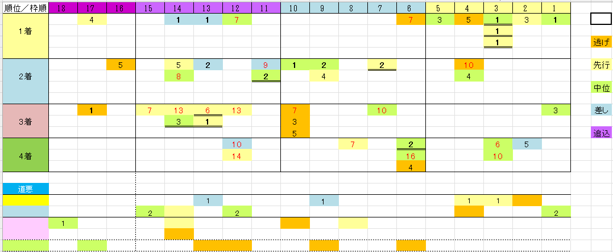

---
title: "菊花賞 展望"
date: 2026-10-23
category: "ギャンブル"
---

※データは～2025年の蓄積

　

●人気から見る傾向

　

・人気筋なら

内枠。かつ戦歴上は前目で競馬する傾向のあった馬

１～５人気まで

　

　

・三冠馬について

皐月賞、ダービーを制覇した「二冠馬」で3,000mに挑戦してくるからには陣営もそれなりの見込みがあってのことか、大敗は無し。

三冠馬　コントレイル(2020年)、ディープインパクト(2005年)、ナリタブライアン(1994年)

２着以下　メイショウサムソン(2006年)２着、ネオユニヴァース(2003年)３着、ミホノブルボン(1992年)４着

回避等　ドゥラメンテ(2015年)、サニーブライアン(1997年)、トウカイテイオー(1991年)

※データは1987年まで　

　

●穴馬の傾向

　

外枠（特に１１番～１５番枠）の先行または差し

　

・稍重以下の場合は？

例外は多いのですが、パターンとして、１，２番人気のワンツーフィニッシュというのがあります。

　

　

