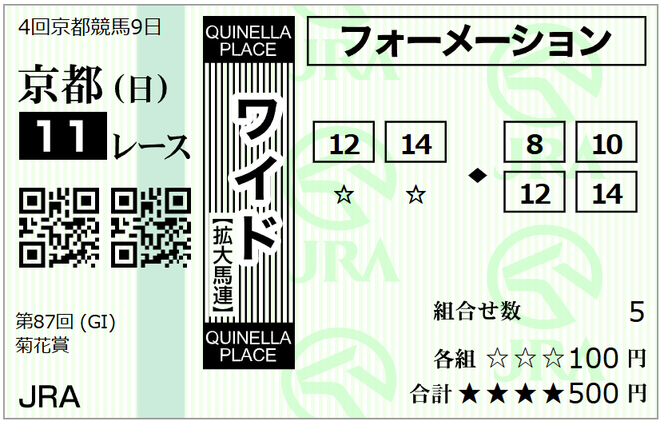
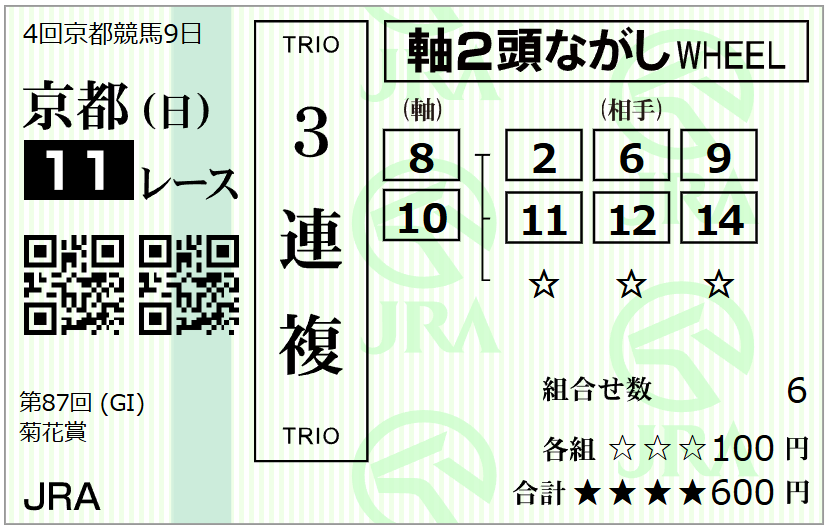
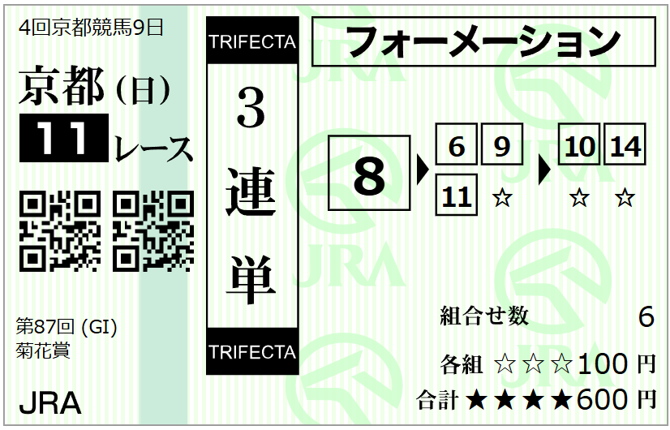
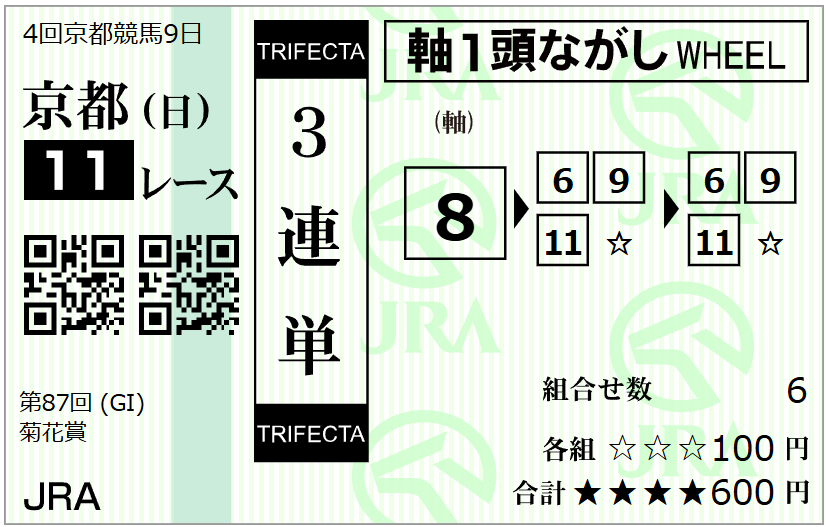

---
title: "2026/10/25 菊花賞　予想"
date: 2026-10-25
category: "ギャンブル"
---

◆データ

　

◎ ⑧ロブチェン

○ －不在-

★ ⑩ダノンヒストリー

☆ ⑥バステール

　

　

◆予想

　

穴　⑭マジョレルブルー

　

◆買い目

競馬誌の記事は、ロブチェンの是非、の一択。その中でも気になるのが、歴代三冠馬の馬体重が重くても470kg台であること。重馬場想定も絡んで、510kg超のロブチェンに不利というのはあり得る話です。つまりマラソンレースは軽量スリム体形が有利ということ。さて、どうでしょう。

　

とりあえず、データ通りの外枠の穴馬を狙ったワイドを押さえて、一旦これを忘れます

なぜかと言うと、２冠馬が出走している場合、独特の条件になり得るからです。つまり、通常年なら連対する馬の層が２，３着。ヒモ（穴）が４着以下の馬券外に沈むケース。個人的に、通常のヒモ穴作戦が使えない可能性の比率が高い感じがします。２－４着とかワイドに引っかからないパターン。

　

おまけに雨で稍重以下がほぼ確定。データ的には、重馬場なら１，２人気が揃って馬券内に来るケースが多いので、３連複２頭軸。

　

で、３連単。どっちにするかですよね。私は、ロブチェンの戴冠を祝える馬券で。

　

今年は、２冠馬ロブチェンが出走します。

コントレイル以来の三冠馬の誕生なるか、の方がレースの焦点ですね。いつもはＴＶ中継で穴馬の帽子色と番号だけを目で追いかけている私も、今回ばかりは、ゴール板を最初に駆け抜ける馬を追いそうです。

　

 

