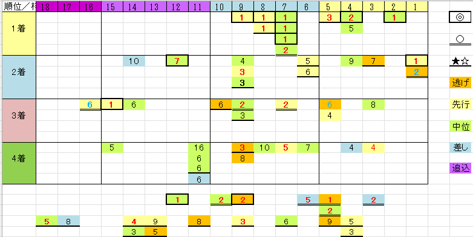

---
title: "天皇賞（秋） 展望"
date: 2026-11-01
category: "ギャンブル"
---

※データは2014年～2025年（ただし重馬場の2017年を除く）

　

●人気から見る傾向

　

・人気筋なら

実績１位◎は極めて好成績

　

　

　

●穴馬の傾向

秋天は原則実力馬が強い、まさにキングディスタンスなレースですが、中穴程度までなら狙えます。

・東京のオープン以上勝ち経験

・四角位置取りが、逃げ～中位のタイプ。差し追いが極めて少なく、近４走で一度でも四角１５番手以下の位置取りだった馬は４着までしか来ていません。

・なぜかの６番人気の好走

　

　

