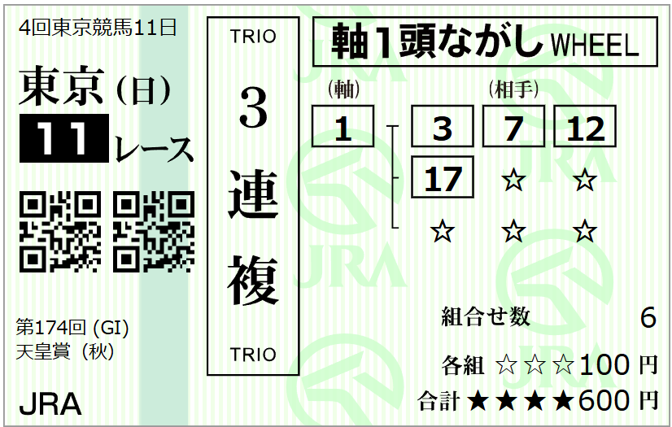

---
title: "2026/11/01 天皇賞　予想"
date: 2026-11-01
category: "ギャンブル"
---

◆データ

　

◎ ①クロワデュノール

○ ⑦マスカレードボール

★ ⑰ダノンデサイル

☆ ⑥セイウンハーデス

　

　

◆予想

本命７→１

ヒモ穴　-不在-

　

・穴馬が、、ふ、不在！？

　

データだけから見ていると、チョイチョイ起きる「○着馬に相当する馬が不在」パターン。

外枠すぎて不利な点を割り引いた⑰ダノンデザイルが、ぎり３着候補。さすがに１７番枠は不利でしょう。 （その点は、JRAサイトのオッズ：人気順リストにおいて、馬連１－７の１番人気や、３連単７⇔１→１７が他とは一線を画した１，２番人気になっている点にも暗に反映されてしまっています（土曜午前中現在）

 

なんか、勝ち負けの競り合いと、３着争いが別の争いになりそうな気が・・・って感じちゃうんですが、過去データを見てみるとそうでもない。偏差値が２頭に集中した過去の回を見ると、意外と

◎１着　○５着以下（◎→☆→★→差）

◎２着　○３着　　（★→◎→○→中）

◎１着　○３着　　（◎→★→○→先）

◎１着　○５着以下（◎→中→☆→先）

◎３着　○５着以下（中→逃→◎→中）

枠順の有利不利が絡む年はもちろんあるんですが、◎が馬券に絡む一方で、○は全て連下。見かけ２強でも、そうはならないこともありえる。

 

◆買い目

 

　

　

