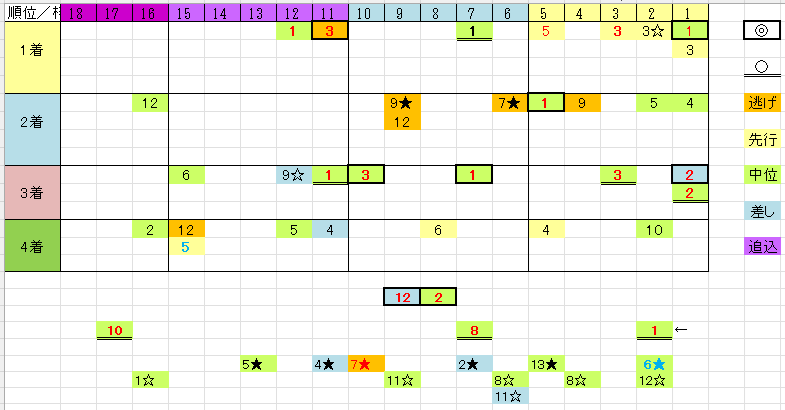

---
title: "エリザベス女王杯　展望"
date: 2026-11-01
category: "ギャンブル"
---
* [-Hyper-Link to this SITE MAP-](../../sitemap.html)
##エリザベス女王杯　展望

※データは2014年～2025年（ただし2020-2022年を除く）

　

●人気から見る傾向

・内枠の人気は高確率

●脚質傾向

・逃げ先行有利

●前走

・なぜか、前走9着以下は、馬券内に来ていません。マキシマムドパリ４着

* [-Hyper-Link to this SITE MAP-](../../sitemap.html)

