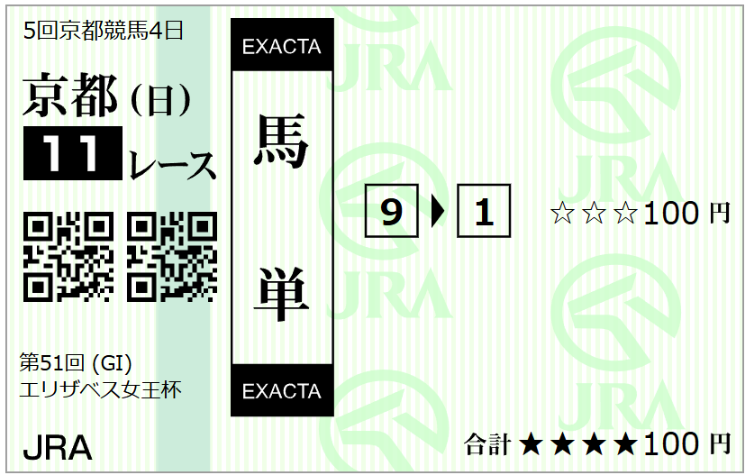

---
title: "2026/11/15 エリザベス女王杯　予想"
date: 2026-11-15
category: "ギャンブル"
---

◆データ

　

◎ ⑦カムニャック

◎ ⑪ジュウリョクピエロ

★ ⑭チェルヴィニア

☆ ⑯アクアヴァーナル

　

※偏差値条件は＜雨、稍重以下＞です

◆予想

　

稍重以下のエリ女って珍しい。データ不足。

９→１

 

◆買い目

軸は重馬場得意の⑨クイーンズウォーク（女王杯だけに！？） 相手は、エリ女でよく来る「ラ行」で始まる馬名で①ラヴァンダ

　

　

