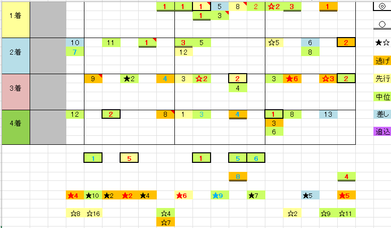

---
title: "有馬記念　展望"
date: 2026-12-27
category: "ギャンブル"
---
* [-Hyper-Link to this SITE MAP-](../../sitemap.html)

<h2>有馬記念　展望</h2>

投票してきました

　

※データは、2015～2025年（計１１回）

※データは年（計 回）

　

●人気から見る傾向

・実績上位◎○なら、３人気まで

・

　

●脚質傾向

・中団より前が多いには多いですが、追い込み以外はまんべんなく、と考えた方がいい

　

●前走

・

　

●その他

・２着馬に、穴傾向

・ヒモ穴に逃げ

・

　

* [-Hyper-Link to this SITE MAP-](../../sitemap.html)

